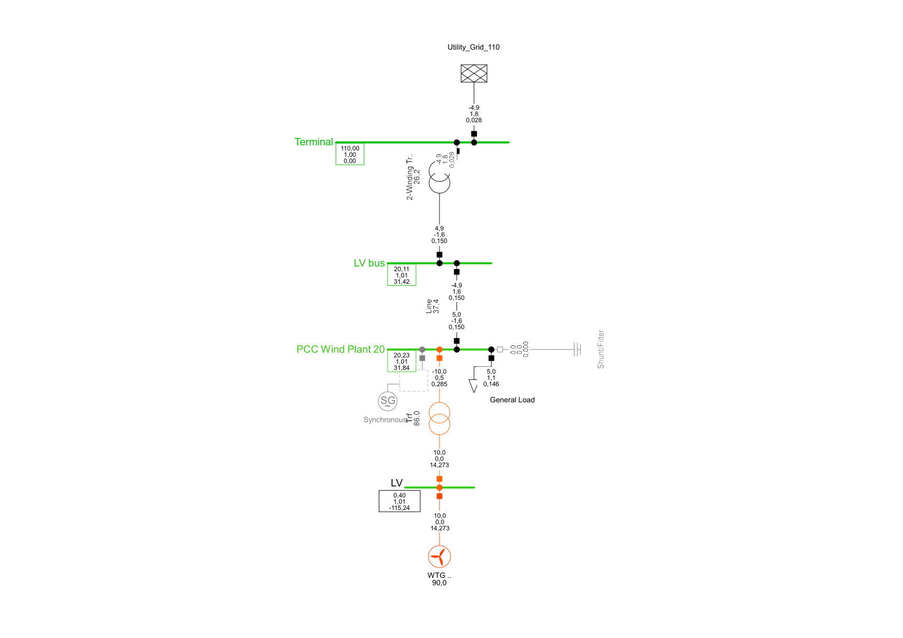
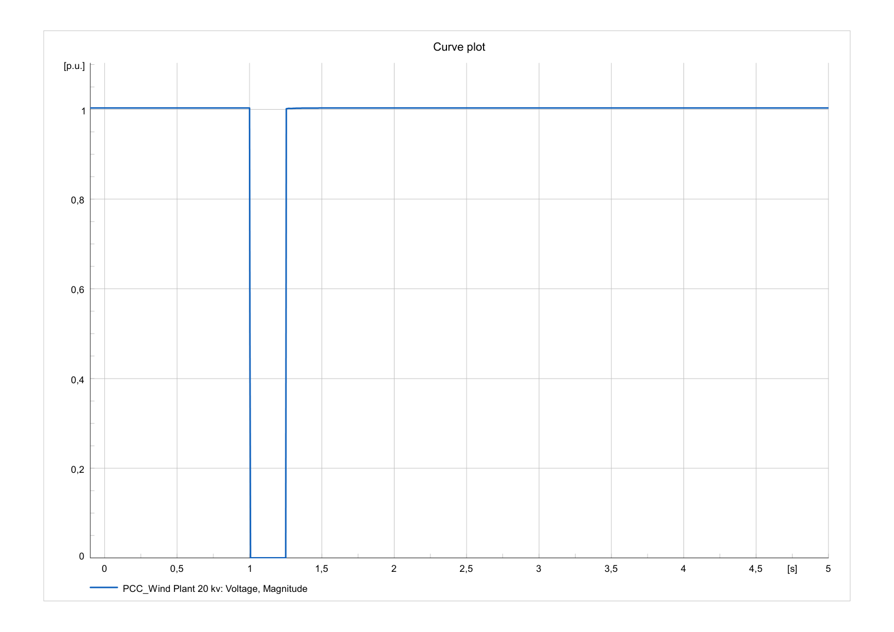

# Type-4 Wind Power Plant Grid Integration Study

**DIgSILENT PowerFactory 2022 · Load flow · Reactive-power control · IEC 60909 short circuit · RMS simulation**

This project examines the connection of a Type-4, fully rated converter wind turbine plant to a 20-kV distribution network. The analysis covers changes in power exchange and PCC voltage under different active- and reactive-power operating conditions, the effect of upstream grid short-circuit strength, and PCC voltage response to three-phase faults.

**Study configurations:** Steady-state load-flow studies use **five 2-MW turbine units (10 MW total)**. Grid-strength and RMS studies use a **single 2-MW turbine** following convergence difficulties with the five-unit RMS model. Results from these configurations are presented separately.

## 1. Network configuration

*Figure 1 — PowerFactory network at 10 MW wind generation, Q = 0 MVAr. The 110-kV utility source is connected to the 20-kV PCC via an upstream transformer and a distribution cable; the wind plant connects through a 0.4/20-kV step-up transformer.*

| Component | Recorded model parameters |
|---|---|
| Utility connection | 110-kV external grid |
| Upstream transformer | 20 MVA; 110/20 kV; short-circuit voltage 3%; copper losses 120 kW; no-load losses 20 kW; no-load current 0.2%; YNd11 |
| Distribution cable | IEE Al–PE 1×400 mm², 12/20-kV designation; 5-km length |
| Local load in steady-state cases | 5 MW and 1.1 MVAr |
| Wind turbine technology | Type-4, fully rated converter; 2 MW per unit |
| Wind turbine step-up transformer | 0.4/20 kV; 2.3 MVA recorded rating |
| Aggregated wind capacity | 5 × 2 MW = 10 MW for load-flow and Q-control cases |
| Reduced wind capacity | 1 × 2 MW = 2 MW for grid-strength and RMS cases |

The generic Type-4 composite model includes converter-control components such as a phase-locked loop (PLL). The detailed performance of those internal controls was not independently established from the recorded RMS signals. Electrical type-library data not supplied in the study notes (including the cable's full R/X/C values and the wind step-up transformer's losses and impedance) are not inferred here.

## 2. Steady-state load flow at different wind production levels

Balanced load-flow calculations were completed at **0%, 50% and 100%** of the 10-MW plant's active-power output. The WTG reactive-power setpoint was held at **0 MVAr**, and local demand was fixed at **5 MW / 1.1 MVAr**.

| Quantity | 0% wind | 50% wind | 100% wind |
|---|---:|---:|---:|
| WTG active-power output | 0 MW | 5 MW | 10 MW |
| WTG reactive-power output | 0 MVAr | 0 MVAr | 0 MVAr |
| PCC voltage | **19.92 kV** | **20.10 kV** | **20.23 kV** |
| Upstream 20-kV bus voltage | 20.10 kV | 20.13 kV | 20.11 kV |
| Utility active-power exchange (approx.) | **5.1 MW import** | **Near zero** | **4.9 MW export** |

With no wind production, the utility supplies the local demand and network losses. At 5 MW wind output, local generation approximately balances the 5-MW load. At 10 MW, surplus power flows back toward the utility grid. The PCC voltage rises by **0.31 kV** (1.55% of the nominal 20 kV) across these cases. This occurs even at WTG Q = 0: active-power flow through the resistive part of network impedance contributes to the voltage change, together with the network's reactive-power balance.

**Original PowerFactory evidence:** [0% production](evidence/original-pdfs/wind-0pct-Q0.pdf) · [50% production](evidence/original-pdfs/wind-50pct-Q0.pdf) · [100% production](evidence/original-pdfs/wind-100pct-Q0.pdf). [Tabulated data](results/wind-generation-load-flow.csv).

## 3. Reactive-power control at full wind generation

At a constant **10 MW active-power output**, total wind plant reactive power was varied between **−2 MVAr (absorption)**, **0 MVAr**, and **+2 MVAr (injection)**. These totals correspond to −0.4, 0 and +0.4 MVAr per turbine in the five-unit operating configuration; the local load was unchanged.

| Total WTG Q | PCC voltage | Upstream 20-kV voltage |
|---|---:|---:|
| −2 MVAr (absorption) | **19.99 kV** | 19.90 kV |
| 0 MVAr | **20.23 kV** | 20.11 kV |
| +2 MVAr (injection) | **20.47 kV** | 20.31 kV |

Reactive-power absorption lowered PCC voltage; injection raised it. The measured difference between the tested endpoints is **0.48 kV** (2.4% of nominal voltage). This demonstrates steady-state voltage sensitivity to wind converter reactive-power setpoints; it does not establish the converter's complete reactive-power capability or dynamic voltage-control performance.

**Original PowerFactory evidence:** [Q = −2 MVAr](evidence/original-pdfs/wind-100pct-Qminus2Mvar.pdf) · [Q = 0 MVAr](evidence/original-pdfs/wind-100pct-Q0.pdf) · [Q = +2 MVAr](evidence/original-pdfs/wind-100pct-Qplus2Mvar.pdf). [Tabulated data](results/reactive-power-control.csv).

## 4. Model simplification for subsequent studies

The original five-unit configuration completed steady-state load flow and static short-circuit calculations, but **RMS dynamic simulation did not converge reliably**. A reduced configuration with **one 2-MW WTG** completed the RMS simulations. Inconsistent aggregation or initialization within the composite dynamic model was considered as a possible explanation, but the specific cause was **not confirmed**.

The next two studies therefore use the reduced 2-MW configuration. This adjustment should not be interpreted as evidence that a five-turbine plant is inherently unstable.

## 5. Upstream grid strength and short-circuit ratio

IEC 60909 three-phase short-circuit calculations were carried out at the **20-kV PCC**, with the WTG **out of service** in both cases. Taking it out of service excludes the turbine's own fault-current contribution and isolates the upstream network's contribution to the PCC short-circuit strength. Merely setting WTG active-power output to 0 MW would not necessarily remove its fault contribution.

The recorded external-grid short-circuit-strength setting was approximately **2000.519 MVA** in the stronger-grid case and **500 MVA** in the reduced-strength case. These source values differ from the resulting PCC short-circuit levels because the intervening transformer and feeder impedances contribute to the equivalent impedance seen at the PCC.

| IEC 60909 result / derived quantity | Stronger grid | Reduced grid strength |
|---|---:|---:|
| PCC short-circuit power, S''k | **163.1 MVA** | **131.4 MVA** |
| PCC initial symmetrical current, I''k | 4.708 kA | 3.793 kA |
| PCC peak current, ip | 9.478 kA | 7.909 kA |
| WTG fault contribution | 0 | 0 |
| Wind plant rating for SCR | 2 MW | 2 MW |
| **SCR** | **81.55** | **65.70** |

Using the 2-MW plant base, the short-circuit ratio is evaluated as:

$$\mathrm{SCR}=\frac{S''_{k,\mathrm{PCC,grid}}}{P_{\mathrm{WTG,rated}}},\qquad \mathrm{SCR}_{\mathrm{strong}}=\frac{163.1}{2}=81.55,\quad \mathrm{SCR}_{\mathrm{reduced}}=\frac{131.4}{2}=65.70.$$

Both values are high. The second case is **less strong than the first**, but the results should not be described as a conventionally weak-grid connection. The source short-circuit-strength entry was recorded as “−2000.519 MVA” in the study notes; a positive **magnitude** is used above, while the recorded negative sign has not been independently resolved from an exported settings screen.

**Original PowerFactory evidence:** [Strong grid case — WTG out of service](evidence/original-pdfs/Strong%20grid%20case.pdf) · [Reduced grid-strength case — WTG out of service](evidence/original-pdfs/reduced-grid-strength-WTG-off.pdf). [Tabulated data](results/grid-strength.csv).

## 6. RMS PCC voltage response to three-phase faults

A three-phase PCC fault was applied at approximately **t = 1.00 s** in RMS simulation with the single 2-MW WTG. The two saved voltage traces show clearing near **1.15 s** and **1.25 s**. Voltage magnitude was observed over a 5-s interval.

| Result | Shorter fault | Longer fault |
|---|---:|---:|
| Approximate clearing time visible in plot | 1.15 s | 1.25 s |
| Approximate fault duration | **150 ms** | **250 ms** |
| PCC voltage during fault | Near 0 pu | Near 0 pu |
| PCC voltage after clearance | Near 1.0 pu | Near 1.0 pu |
| Distinct post-clearance recovery ramp | Not resolved | Not resolved |

| Shorter fault: PCC voltage | Longer fault: PCC voltage |
|---|---|
|  |  |

The longer fault extends the near-zero PCC voltage interval by approximately **100 ms**. In both traces, the PCC voltage recovers to approximately its pre-fault magnitude at the resolution of the plots after fault removal. The plots **do not establish the turbine's active-power recovery, converter current response, or fault-ride-through compliance**; the WTG RMS power-result channel did not provide usable measurements.

**Timing qualification:** The original PDF filename for the shorter fault refers to “clear at 1.10”, whereas the visible voltage transition is near **1.15 s**. The duration above is therefore identified **from the saved plot**; the exact event definition was not independently verified from an exported event-settings record.

**Original PowerFactory evidence:** [Shorter fault](evidence/original-pdfs/rms-voltage-shorter-fault.pdf) · [Longer fault](evidence/original-pdfs/rms-voltage-longer-fault.pdf). [Tabulated data](results/rms-fault-cases.csv).

## 7. Technical conclusions

- Changing wind generation from **0 to 10 MW** at Q = 0 increased PCC voltage from **19.92 to 20.23 kV** and changed the utility interface from importing to exporting active power.
- At **10 MW**, moving from **−2 MVAr absorption** to **+2 MVAr injection** increased PCC voltage from **19.99 to 20.47 kV**.
- On the **single-turbine 2-MW base**, reducing upstream source strength lowered PCC fault level from **163.1 to 131.4 MVA** and calculated SCR from **81.55 to 65.70**.
- RMS voltage traces showed severe voltage depression during both three-phase faults and recovery of **PCC voltage**, not independently verified recovery of the turbine's electrical power.

## Repository contents and model access

| Location | Contents |
|---|---|
| [`figures/`](figures/) | Single-line diagram and original RMS voltage-plot images |
| [`results/`](results/) | Machine-readable CSV comparison tables |
| [`evidence/original-pdfs/`](evidence/original-pdfs/) | Original PowerFactory study results (preserved as PDFs) |
| [`model/`](model/) | User-provided PowerFactory `.pfd` export and import notes |

The model export has **not** been executed or checked for portability in this repository-building environment. Reproduction requires a compatible DIgSILENT PowerFactory installation and access to any referenced local models or libraries. Before publishing the `.pfd`, confirm you have permission to redistribute its contents and dependencies. This repository documents an educational engineering study, not a certified grid-code or protection-compliance assessment.
